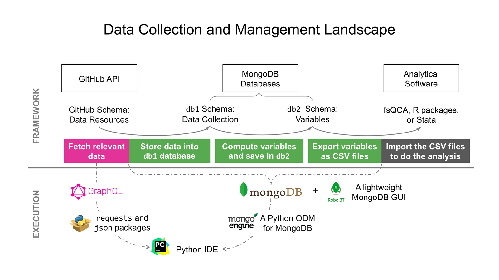

# Collective Attention: Code Transparency Package

This repository contains the code and outputs behind the paper:

> Yanran Liu & Arun Rai. COLLECTIVE ATTENTION CONFIGURATIONS IN OPEN-SOURCE SOFTWARE DEVELOPMENT: INTERLACING FOR HIGH PERFORMANCE. *MIS Quarterly*, forthcoming. [DOI to be assigned]

| Folder | Contents |
|---|---|
| [`code_data_collection/`](code_data_collection/) | Collects the paper's GitHub data (machine-learning repositories; issues, pull requests, commits, timeline events) into MongoDB. See its [README](code_data_collection/README.md). |
| [`code_data_analysis/`](code_data_analysis/) | Builds the sample and variables (Section 5), writes the files analyzed in fsQCA 3.0, and merges and extends the results (Section 6, Appendices A–B). See its [README](code_data_analysis/README.md) for the full pipeline, the variable map, and the robustness tests. |
| [`data_truthTables_results/`](data_truthTables_results/) | Outputs of the published analyses: final samples, descriptive statistics, correlations, fsQCA truth tables and solutions, necessity analyses, robustness tests, and merged tables |
| [`data_OSS.csv`](data_OSS.csv) | Release-cycle-level dataset of the main-analysis sample (4,291 release cycles, 1,004 projects): the paper's variables plus additional variables for future research |
| [`data_OSS_variables.xlsx`](data_OSS_variables.xlsx) | Definitions of the variables in `data_OSS.csv` |
| [`data_collection_landscape.png`](data_collection_landscape.png) | Overview of the data collection and management workflow (shown below) |

## Workflow



*How to read the figure.* The upper half (Framework) shows the flow of data. The lower half (Execution) shows the tools used. In the code:
- **db1** is `db1_small` (raw GitHub data) together with `db1_small_analysis` (derived collections, such as classified outputs and release cycles).
- **db2** is `db2_paper_r4` (release-cycle-level variables).
- The analytical software is fsQCA 3.0 (truth tables and solutions), R with the `QCA` package (necessity analyses) and Stata 14 (deviation-score analyses).
- PyCharm and Robo 3T are the IDE and MongoDB viewer the authors used. Any equivalent tools work.

1. **Data collection** (`code_data_collection/`): GitHub GraphQL and REST APIs → MongoDB `db1_small` (raw data of 36,280 machine-learning projects, then 2,539 with a codebase and releases). The collection ran on three machines in parallel, each on a different part of the repository list, with the same code.
2. **Analysis** (`code_data_analysis/`, steps 1–6): MongoDB → release cycles, collective-attention attributes, outcomes, contingencies → calibrated CSV files.
3. **fsQCA 3.0** (by hand): truth tables and solutions for each outcome and subsample.
4. **Results** (`code_data_analysis/`, step 7): merged truth tables (Python), necessity analyses (R, `QCA` package), and deviation-score analyses (Stata 14).

Variable names in the code and in all output files follow the paper: dpi, dsi, tpi, tsi (discursive/technical primary/secondary integration), task_interdependence, discursive_task_interdependence, technical_task_interdependence. Intermediate fields stored in MongoDB keep their original names; [`code_data_analysis/README.md`](code_data_analysis/README.md) maps them to the paper's variables.

## Data availability

The raw GitHub data (MongoDB databases) are not redistributed; `code_data_collection/` retrieves them from the public GitHub API. All analysis-ready data, including the release-cycle-level samples, calibrated fsQCA input files, truth tables and results, are provided in `data_truthTables_results/`.

### Dataset for future research (`data_OSS.csv`)

`data_OSS.csv` has one row per release cycle (identified by `repository` and `cycleNumber`) for the 4,291 release cycles of the main analysis. `data_OSS_variables.xlsx` defines each variable. It contains:
- **Variables used in the paper,** with uncalibrated values identical to `data_truthTables_results/main/sample0.csv`:
  - outcomes: `speed`, `novelty`, `quality`
  - collective attention attributes: `dpi`, `dsi`, `tpi`, `tsi`
  - contingencies: `task_interdependence`, `org`, `days`
- **Additional variables** computed while developing and revising the paper, not used in the reported analyses:
  - size of the collective and of the work (`num_developers`, `num_discursiveTasks`, `num_technicalTasks`, `total_commits`, `total_additions`, `total_deletions`, `total_comments_dev`, `total_comments_user`)
  - developers' project tenure (`ave_tenure`, `sd_tenure`, `tenure_disparity`)
  - concentration of code contributions (`star`)
  - project age at the start of the cycle (`project_stage`)

Researchers who build on this dataset are asked to cite the paper above.

---

## Credentials: supply your own GitHub token

The code calls the GitHub GraphQL API (v4) and REST API (v3), and both need a GitHub **personal access token**. **No tokens are included in this repository.** You must create your own and provide it through environment variables:

1. Create a token at GitHub → *Settings* → *Developer settings* → *Personal access tokens*. To read public repositories, the token needs no scopes, or only read-only access to public repositories.
2. Set it as an environment variable before running the code:

   ```bash
   export GITHUB_TOKEN="your_token_here"
   ```

3. *(Optional)* `code_data_collection/fetchGitHub/fetchcommit.py` can rotate among three tokens to spread the REST API rate limit (5,000 requests per hour per token). To use this feature, set any of the following variables. Any that are not set fall back to `GITHUB_TOKEN`.

   ```bash
   export GITHUB_TOKEN_1="..."
   export GITHUB_TOKEN_2="..."
   export GITHUB_TOKEN_3="..."
   ```

Do **not** write tokens into the source files. `.env` files are excluded by `.gitignore`.

## Local file paths: replace the placeholders

File locations that pointed to the authors' machines have been replaced with placeholders such as `/path/to/project/...`, `/path/to/output/...` and `/path/to/data_truthTables_results/`. Replace them with locations on your machine before running a script. Relative paths (e.g., `logs/...`) are resolved from the folder of the script's `main.py`.

## Requirements

- **MongoDB**, running locally on the default port (`mongodb://localhost:27017`)
- Python:
  - Data collection: Python 3.7 (the version used for the original runs), with `mongoengine`, `pymongo`, `requests`, `pathlib2`
  - Analysis: Python 3.8 or later; packages listed in [`code_data_analysis/README.md`](code_data_analysis/README.md)
- fsQCA 3.0; R with the `QCA` package; Stata 14 with `outreg2`

## MongoDB databases

| Database | Contents | Used by |
|---|---|---|
| `db1_small` | Raw GitHub data of the paper's sample (2,539 machine-learning projects) | written by `code_data_collection`; read by `code_data_analysis` (alias `core`) |
| `db1_small_analysis` | Derived collections: actions, classified outputs and issues, release cycles | `code_data_analysis` (alias `analysis`) |
| `db2_paper_r4` | Release-cycle-level data and variables used in the paper | `code_data_analysis` (alias `paper_r2`) |

---

## Data collection (`code_data_collection/`)

The steps, from the repository search (`is:public is:root topic:machine-learning`, created 2008–2019) to issues, pull requests, commits and timeline events, are described in [`code_data_collection/README.md`](code_data_collection/README.md). **Do not run its `main.py` as it is:** its `main()` is left in the state of a repair run that deletes and re-fetches the events of one pull request.

Notes on reproducing the collection:
- **Collection period.** The data were collected from the live GitHub API in 2020. Because repositories are deleted, renamed, and edited over time, re-running the code will not produce exactly the same dataset.
- **Manual restarts.** Long runs were restarted by hand after connection or rate-limit failures, using hard-coded start indices.
- **Rate limits.** The code checks the remaining API quota and sleeps until it resets.

---

## License

- **Code** (`code_data_collection/`, `code_data_analysis/`): MIT License. See [`LICENSE`](LICENSE).
- **Data and documentation** (`data_OSS.csv`, `data_OSS_variables.xlsx`, `data_truthTables_results/`, the README files and the figure): Creative Commons Attribution 4.0 International (CC BY 4.0). See [`LICENSE-DATA`](LICENSE-DATA).

Please cite the paper above when you use these materials. The data were derived from public GitHub data collected through the GitHub API.

## Contact

Yanran Liu, yanran.liu@uc.edu
